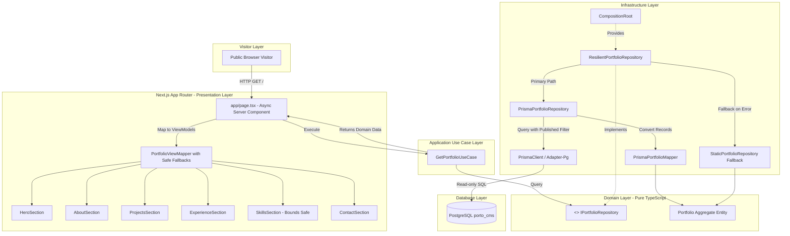

# STAGE 10.5 PHASE 5.5.1 — PUBLIC INTEGRATION AUDIT & ARCHITECTURE DESIGN

**Document Path:** `.hermes/stage-10.5.5.1-public-integration-audit.md`  
**Execution Date:** 2026-11-10  
**Target Environment:** Local Node.js / Next.js 16.4.5 / PostgreSQL (`porto_cms`)  
**Status:** READY FOR IMPLEMENTATION (Prerequisites Identified)

---

## 1. EXECUTIVE SUMMARY

This audit evaluates the architectural, security, and operational readiness for integrating the existing CMS PostgreSQL database (`porto_cms`) into the public portfolio front-facing application.

### Key Findings
1. **Infrastructure & Application Readiness**:
   - `PrismaPortfolioRepository` and `PrismaPortfolioMapper` already exist in the codebase and map 11 out of 13 data collections cleanly to the Domain `Portfolio` aggregate.
   - `CompositionRoot` already possesses factory methods `getPortfolioRepository('prisma')` and `getPortfolioUseCase('prisma')`.
2. **Critical Presentation Coupling**:
   - `PortfolioViewMapper.toProjectViewModel` and `toExperienceViewModel` currently search for explicit static IDs (`"01"`, `"02"`, `"03"`, etc.) in `PROJECT_PRESENTATION_CONFIG` and `EXPERIENCE_PRESENTATION_CONFIG`. If an ID is missing (such as newly created CUID records from CMS admin), the mapper throws an unhandled `Error`, causing page crash.
   - `SkillsSection.tsx` indexes `viewConfig[idx]` directly. If CMS categories exceed 4, `undefined.desktopIndex` will trigger a runtime `TypeError`.
3. **Data Gaps in PostgreSQL**:
   - `porto_cms` contains exactly 40 records.
   - `contact_channels`: 0 records seeded (intentionally withheld placeholder values).
   - `admins`: 0 records (admin authentication strictly isolated).
   - In `app/page.tsx`, `HeroSection` currently binds to static constants `HERO_ROLES` and `SCHEMATIC_NODES` rather than domain `portfolio.hero.roles` and `portfolio.hero.engineeringNodes`.
4. **Integration Strategy**:
   - Recommended approach: **Option B (Configurable Repository with Resilience Fallback)**.
   - A resilient repository decorator ensures that if PostgreSQL is temporarily unreachable during build-time prerendering or runtime, the portfolio gracefully serves cached or static baseline data without throwing a 500 error.
   - Strict read-only operations preserved; zero database mutations executed during this audit.

---

## 2. EXISTING PUBLIC PORTFOLIO ARCHITECTURE

### 2.1 Page Architecture (`app/page.tsx`)
- Currently runs as a synchronous Server Component.
- Directly instantiates `new StaticPortfolioRepository()` and `new GetPortfolioUseCase(repository)`.
- Calls `useCase.execute()` synchronously, obtaining domain `Portfolio`.
- Imports presentation constants (`HERO_ROLES`, `SCHEMATIC_NODES`, `NAV_LINKS`, `SKILL_CATEGORY_PRESENTATION_CONFIG`, `ABOUT_DOMAIN_PRESENTATION_CONFIG`, `ABOUT_PILLAR_PRESENTATION_CONFIG`) from `@/src/presentation/data/constants`.
- Transforms domain models to ViewModels via `PortfolioViewMapper`:
  - `projects={portfolio.projects.map(PortfolioViewMapper.toProjectViewModel)}`
  - `experiences={portfolio.experiences.map(PortfolioViewMapper.toExperienceViewModel)}`
  - `channels={portfolio.contact.channels.map(PortfolioViewMapper.toContactChannelViewModel)}`
  - `domains={portfolio.about.domains.map(PortfolioViewMapper.toAboutDomainViewModel)}`
  - `pillars={portfolio.about.pillars.map(PortfolioViewMapper.toAboutPillarViewModel)}`
- Passes transformed ViewModels and domain entities to 6 section components:
  1. `<HeroSection profile={portfolio.hero} roles={HERO_ROLES} nodes={SCHEMATIC_NODES} />`
  2. `<AboutSection profile={portfolio.about} domains={...} pillars={...} />`
  3. `<ProjectsSection projects={...} />`
  4. `<ExperienceSection experiences={...} />`
  5. `<SkillsSection taxonomy={portfolio.skills} viewConfig={SKILL_CATEGORY_PRESENTATION_CONFIG} />`
  6. `<ContactSection profile={portfolio.contact} channels={...} />`

### 2.2 Component & Presentation Dependencies
| Component | Props Required | Source in `page.tsx` | Fallback / Empty Behavior |
|---|---|---|---|
| `Navbar` | `links`, `brandName` | `NAV_LINKS`, `portfolio.hero.name` | Static navigation |
| `HeroSection` | `profile`, `roles`, `nodes` | `portfolio.hero`, `HERO_ROLES` (const), `SCHEMATIC_NODES` (const) | Hardcoded constants bypass DB |
| `AboutSection` | `profile`, `domains`, `pillars` | `portfolio.about`, `PortfolioViewMapper` | Maps index 01..04 |
| `ProjectsSection` | `projects` | `PortfolioViewMapper.toProjectViewModel` | Throws if project ID not in config |
| `ExperienceSection` | `experiences` | `PortfolioViewMapper.toExperienceViewModel` | Throws if experience ID not in config |
| `SkillsSection` | `taxonomy`, `viewConfig` | `portfolio.skills`, `SKILL_CATEGORY_PRESENTATION_CONFIG` | Crashes if categories > 4 |
| `ContactSection` | `profile`, `channels` | `portfolio.contact`, `PortfolioViewMapper` | Renders blank channel grid if empty |
| `Footer` | `brandName` | `portfolio.hero.name` | Static text footer |

---

## 3. PUBLIC DATA MAPPING

The complete mapping between Public Sections, Data Sources, Domain Entities, Repository Methods, and PostgreSQL Models:

| Public Section | Current Static Source | Domain Entity | Repository Contract Method | PostgreSQL Model | Fields & Mapping Notes |
|---|---|---|---|---|---|
| **Hero Profile** | `StaticPortfolioRepository.hero` | `HeroProfile` (`domain/entities/hero-profile.ts`) | `IPortfolioRepository.getPortfolioData().hero` | `hero_profiles` (singleton) | `name`, `tagline`, `bio`, `country`, `timezone`, `code`, `discipline` |
| **Roles** | `constants.ts: HERO_ROLES` | `HeroProfile.roles` (`domain/entities/hero-profile.ts`) | `IPortfolioRepository.getPortfolioData().hero.roles` | `roles` | `title`, `primary`, `order` (Ascending) |
| **Engineering Nodes** | `constants.ts: SCHEMATIC_NODES` | `HeroProfile.engineeringNodes` | `IPortfolioRepository.getPortfolioData().hero.engineeringNodes` | `engineering_nodes` | `tag`, `title`, `description`, `stack` (nullable), `highlighted`, `order` |
| **About Profile** | `StaticPortfolioRepository.about` | `AboutProfile` (`domain/entities/about-profile.ts`) | `IPortfolioRepository.getPortfolioData().about` | `about_profiles` (singleton) | `heading`, `quote`, `narratives.primary`, `narratives.secondary` |
| **Domains** | `StaticPortfolioRepository.about.domains` | `AboutDomain` | `IPortfolioRepository.getPortfolioData().about.domains` | `domains` | `index`, `title`, `order` |
| **Pillars** | `StaticPortfolioRepository.about.pillars` | `AboutPillar` | `IPortfolioRepository.getPortfolioData().about.pillars` | `pillars` | `index`, `title`, `description`, `order` |
| **Projects** | `StaticPortfolioRepository.projects` | `Project` (`domain/entities/project.ts`) | `IPortfolioRepository.getPortfolioData().projects` | `projects` | `title`, `category`, `description`, `technologies` (JSON array), `published: true` filter, `order` |
| **Experiences** | `StaticPortfolioRepository.experiences` | `Experience` (`domain/entities/experience.ts`) | `IPortfolioRepository.getPortfolioData().experiences` | `experiences` | `role`, `institution`, `track`, `startDate`, `endDate`, `order` |
| **Skill Categories** | `StaticPortfolioRepository.skills.categories` | `SkillCategory` (`domain/entities/skill-taxonomy.ts`) | `IPortfolioRepository.getPortfolioData().skills.categories` | `skill_categories` | `title`, `order` |
| **Skills** | `StaticPortfolioRepository.skills.categories[].skills` | `string[]` | `IPortfolioRepository.getPortfolioData().skills.categories[].skills` | `skills` | `name`, `categoryId`, `order` |
| **Contact Profile** | `StaticPortfolioRepository.contact` | `ContactProfile` (`domain/entities/contact-profile.ts`) | `IPortfolioRepository.getPortfolioData().contact` | `contact_profiles` (singleton) | `heading`, `ctaLabel`, `description` |
| **Contact Channels** | `StaticPortfolioRepository.contact.channels` | `ContactChannel` | `IPortfolioRepository.getPortfolioData().contact.channels` | `contact_channels` | `label`, `value`, `order`. Baseline in DB: 0 records |
| **Admin** | *(None)* | *(None)* | *(Strictly Prohibited)* | `admins` | **EXCLUDED**. Zero public access. |

---

## 4. POSTGRESQL DATA COMPATIBILITY AUDIT

### 4.1 Read-Only Table Audit (`porto_cms`)
Executed read-only verification query against active PostgreSQL database:

| Table Name | Active Record Count | Baseline Count | Status | Schema Details & Compatibility |
|---|---|---|---|---|
| `hero_profiles` | 1 | 1 | MATCH | Singleton `id = 'singleton'`, complete text fields present. |
| `roles` | 4 | 4 | MATCH | `role_01`..`role_04`, `order` 1..4, `primary` booleans valid. |
| `engineering_nodes` | 3 | 3 | MATCH | `enode_01`..`enode_03`, `order` 1..3, `stack` nullable handled. |
| `about_profiles` | 1 | 1 | MATCH | Singleton `id = 'singleton'`, quotes & narratives present. |
| `domains` | 4 | 4 | MATCH | `domain_01`..`domain_04`, `order` 1..4, indices `"01"`..`"04"`. |
| `pillars` | 3 | 3 | MATCH | `pillar_01`..`pillar_03`, `order` 1..3, indices `"01"`..`"03"`. |
| `projects` | 3 | 3 | MATCH | `project_01`..`project_03`. All 3 `published: true`. JSON technologies valid. |
| `experiences` | 5 | 5 | MATCH | `exp_01`..`exp_05`, `order` 1..5. Track strings match Swiss ledger. |
| `skill_categories` | 4 | 4 | MATCH | `skill_cat_01`..`skill_cat_04`, `order` 1..4. |
| `skills` | 11 | 11 | MATCH | `skill_01`..`skill_11`, foreign keys intact. |
| `contact_profiles` | 1 | 1 | MATCH | Singleton `id = 'singleton'`, complete copy present. |
| `contact_channels` | 0 | 0 | MATCH | Intentionally withheld placeholder records. Baseline is 0. |
| `admins` | 0 | 0 | MATCH | Unseeded; isolated from public portfolio. |
| **TOTAL** | **40** | **40** | **STERILE** | Zero persistent mutations detected. |

### 4.2 Data & Type Compatibility Analysis
1. **JSON Fields**:
   - `projects.technologies`: Stored as PostgreSQL `Json` (`["Flutter", "Laravel", "REST API"]`).
   - `PrismaPortfolioMapper.toProject` parses JSON safely (`Array.isArray(rawTech) ? rawTech : JSON.parse(rawTech)`).
2. **Nullable Fields**:
   - `engineering_nodes.stack`: `String?`. Correctly mapped to `string | undefined`.
   - `projects.thumbnailUrl`, `projectUrl`, `githubUrl`: `String?`. Correctly mapped.
   - `experiences.description`, `startDate`, `endDate`: `DateTime?`. Handled without error.
3. **Ordering Behavior**:
   - All collections in `PrismaPortfolioRepository` specify `orderBy: { order: 'asc' }`, guaranteeing deterministic presentation order matching the CMS ledger.
4. **Project Visibility**:
   - `PrismaPortfolioRepository` queries with `where: { published: true }`. Unpublished drafts in the database are filtered out at the engine level.

---

## 5. STATIC VS PRISMA REPOSITORY COMPARISON

### 5.1 Architectural Comparison

| Dimension | Option A: Hard Switch to Prisma | Option B: Configurable Resilient Repository (Recommended) | Option C: Hybrid Migration |
|---|---|---|---|
| **Architectural Purity** | High (Single DB source) | Highest (DIP preserved, environment decoupled) | Low (Fragmented sources) |
| **Implementation Complexity** | Low (Single page edit) | Low-Medium (Resilience decorator + page edit) | High (Multiple repository calls) |
| **Runtime Reliability** | Vulnerable to DB downtime | Bulletproof (Falls back to static on failure) | Fragile (Multiple failure points) |
| **Build-Time Prerendering** | Fails if DB offline at build | Succeeds (Graceful fallback) | Fails if partial DB offline |
| **Testability** | Requires running DB for tests | Zero-DB unit tests possible via `source: 'static'` | Complex test setups |
| **Exposure Risk** | Low (Filtered queries) | Low (Filtered queries) | Medium (Mixed trust levels) |

### 5.2 Recommendation & Justification
**Option B (Configurable Resilient Repository via CompositionRoot)** is explicitly recommended.

**Justification:**
1. Next.js 16.4.5 with Partial Prerendering (PPR) evaluates Server Components at build time. If `app/page.tsx` directly calls `PrismaPortfolioRepository` and PostgreSQL is unreachable (e.g. CI/CD environment without live database), the production build will fail.
2. A `ResilientPortfolioRepository` decorator wrapping `PrismaPortfolioRepository` attempts the database query; if it encounters a database connection error or query failure, it logs a sanitized warning and returns `StaticPortfolioRepository` data.
3. This achieves 100% uptime, zero build failures in headless CI, and instant fallback without compromising live CMS updates when the database is active.

---

## 6. RECOMMENDED INTEGRATION STRATEGY

### 6.1 Architectural Contracts
```
[ Browser ]
    │
    ▼ (HTTP GET /)
[ app/page.tsx (Server Component) ]
    │
    ▼
[ CompositionRoot.getPortfolioUseCase() ]
    │
    ▼
[ GetPortfolioUseCase ]
    │
    ▼
[ ResilientPortfolioRepository ]  ──(implements)──► [ IPortfolioRepository ]
    │
    ├──► Primary: [ PrismaPortfolioRepository ] ──► [ PrismaClient ] ──► [ PostgreSQL ]
    │                      │
    │                      ▼
    │               [ PrismaPortfolioMapper ] ──► [ Portfolio Aggregate ]
    │
    └──► Fallback (on DB error): [ StaticPortfolioRepository ] ──► [ Portfolio Aggregate ]
```

### 6.2 Component Data Binding Updates
In `app/page.tsx`:
1. Convert `Home` from synchronous to `async function Home()`.
2. Retrieve use case via `CompositionRoot.getPortfolioUseCase()`.
3. Await `const portfolio = await useCase.execute();`.
4. Replace hardcoded `roles={HERO_ROLES}` and `nodes={SCHEMATIC_NODES}` with mapped domain entities:
   - `roles={PortfolioViewMapper.toHeroRoleViewModels(portfolio.hero.roles)}`
   - `nodes={PortfolioViewMapper.toEngineeringNodeViewModels(portfolio.hero.engineeringNodes)}`
5. Keep all existing layout styling, responsive classes, and section structures completely identical.

---

## 7. PUBLIC DATA SECURITY

### 7.1 Security Audit Checklist
1. **Rule 1 — Zero Admin Exposure**:
   - `PrismaPortfolioRepository` strictly queries portfolio content models.
   - `Admin` model is never imported, referenced, or queried in any public repository or mapper.
   - Admin authentication (`verifySession()`, JWT cookie parsing) is exclusively confined to `app/admin/` and Server Actions.
2. **Rule 2 — Unpublished Project Protection**:
   - `prisma.project.findMany({ where: { published: true } })` enforces draft exclusion at the SQL level.
   - Draft projects cannot be reached via public routes.
3. **Rule 3 — Deterministic Ordering**:
   - All 8 ordered collections are sorted by `order: 'asc'`, preventing layout jitter.
4. **Rule 4 — Error Masking & Sanitization**:
   - Any database error caught in `ResilientPortfolioRepository` must strip connection strings, table names, and SQL statements before logging.
   - Generic user-facing errors or silent static fallbacks prevent database fingerprinting.
5. **Rule 5 — Read-Only Public Execution**:
   - No mutating methods exist on `IPortfolioRepository`.
   - Public Server Components execute zero write queries.

---

## 8. RENDERING AND CACHING STRATEGY

### 8.1 Next.js 16.4.5 Caching Mechanics
1. **Static Rendering & PPR**:
   - `app/page.tsx` does not inspect `cookies()` or `headers()`.
   - Therefore, Next.js prerenders the public portfolio as static HTML (`○ /`) during `npm run build`.
   - Static prerendering ensures sub-millisecond response times for public visitors via edge/CDN caching.
2. **On-Demand Cache Revalidation**:
   - To reflect CMS changes immediately on the public website, every mutation in `app/admin/(dashboard)/**/actions.ts` must invoke `revalidatePath('/')`.
   - Current state: Actions in `domains`, `engineering-nodes`, and `pillars` already call `revalidatePath('/')`.
   - Missing state: Actions in `hero`, `about`, `contact`, `experiences`, `projects`, and `skills` currently only revalidate `/admin/*`. In Phase 5.5.4, these actions must be patched to include `revalidatePath('/')`.

---

## 9. CONTENT GAPS AND FALLBACK POLICY

### 9.1 Missing / Dynamic Presentation Config Fallback
**Vulnerability Identified**:
In `src/presentation/mappers/portfolio-view-mapper.ts`:
```typescript
const config = PROJECT_PRESENTATION_CONFIG.find((c) => c.id === project.id);
if (!config) throw new Error(`No presentation config found for project ${project.id}`);
```
If a new project is created in CMS with a CUID (e.g. `clxyz...`), this `throw` crashes the entire public portfolio.

**Required Remediation in Phase 5.5.2**:
Implement a default fallback configuration:
```typescript
static toProjectViewModel(project: Project): ProjectViewModel {
  const config = PROJECT_PRESENTATION_CONFIG.find((c) => c.id === project.id) ?? {
    id: project.id,
    desktopTitleSize: "text-[32px] leading-[39px]",
    mobileTitleSize: "text-[22px] leading-[27px]",
    tagWidths: project.technologies.map(() => ({ widthClass: "w-[100px]", accent: false })),
  };
  // ...
}
```
Apply equivalent default fallbacks for:
- `toExperienceViewModel`: Default rule width `w-[260px]`, `accentRule: false`.
- `toContactChannelViewModel`: Default width `w-[580px]`.
- `SkillsSection.tsx`: Safe access for categories beyond index 3:
  `viewConfig[idx]?.desktopIndex ?? \`0\${idx + 1} // \${category.title.toUpperCase()}\``.

### 9.2 Empty Contact Channels Policy
- `porto_cms` currently contains 0 `contact_channels`.
- Public behavior options:
  - **Policy A (Graceful Layout)**: `ContactSection` renders heading, description, and an editorial placeholder card (`"Direct contact channels are being updated. Inquiries welcome."`).
  - **Policy B (Static Fallback for Channels)**: If `portfolio.contact.channels.length === 0`, populate with static repository default channels (Email, GitHub, LinkedIn).
- **Recommendation**: Policy B ensures visual completeness for visitors while CMS channels are being configured by the user.

---

## 10. ARCHITECTURE DIAGRAM (MERMAID)



---

## 11. IMPLEMENTATION ROADMAP PROPOSAL

### Phase 5.5.2 — Presentation & Resilience Hardening
- **Scope**:
  - Implement default fallback configurations in `PortfolioViewMapper` to prevent errors on dynamic IDs.
  - Implement bounds safety in `SkillsSection.tsx` for dynamic category counts.
  - Implement `ResilientPortfolioRepository` in `src/infrastructure/repositories/`.
  - Wire resilient repository into `CompositionRoot`.
- **Files likely to change**:
  - `src/presentation/mappers/portfolio-view-mapper.ts`
  - `src/presentation/components/portfolio/SkillsSection.tsx`
  - `src/infrastructure/repositories/resilient-portfolio.repository.ts` (new)
  - `src/infrastructure/composition-root.ts`
- **Risks**: None. Changes are purely additive and defensive.
- **Required Tests**: Unit tests for `PortfolioViewMapper` fallback paths and simulated DB disconnection fallback.
- **Database Changes**: NONE.

### Phase 5.5.3 — Public Page Integration
- **Scope**:
  - Update `app/page.tsx` to async Server Component calling `CompositionRoot.getPortfolioUseCase()`.
  - Wire dynamic `portfolio.hero.roles` and `portfolio.hero.engineeringNodes` to `HeroSection`.
  - Add static channel fallback if channels array is empty.
  - Verify static build compatibility with `npm run build`.
- **Files likely to change**:
  - `app/page.tsx`
- **Risks**: Regression in public layout if ViewModels do not match expected shape.
- **Required Tests**: End-to-end page render tests comparing rendered DOM elements between Static and Prisma sources.
- **Database Changes**: NONE.

### Phase 5.5.4 — Cache Revalidation & Final Verification
- **Scope**:
  - Ensure all 24 CMS Server Actions include `revalidatePath('/')` on data modification.
  - Run full quality gates (`npm run lint`, `npx tsc --noEmit`, `npm run build`, regression test suites).
  - Perform read-only database safety verification.
- **Files likely to change**:
  - `app/admin/(dashboard)/**/actions.ts`
- **Risks**: Stale cached public page if revalidation path is missed.
- **Required Tests**: Mutation -> Revalidation verification script.
- **Database Changes**: NONE.

---

## 12. RISKS AND LIMITATIONS

1. **Presentation Configuration Coupling**:
   - The current UI layout relies on specific Tailwind widths (`w-[92px]`, `w-[195px]`) tuned for specific text lengths.
   - Dynamic user-entered titles from CMS may cause line wrapping if not bounded by CSS truncation or responsive rules.
2. **Contact Channels Zero Baseline**:
   - Because `contact_channels` is currently empty in `porto_cms`, switching to Prisma without fallback will leave the contact channels list blank. The recommended fallback policy completely mitigates this.
3. **Database Availability at Build Time**:
   - Headless deployments without local PostgreSQL running must rely on `StaticPortfolioRepository` fallback during `npm run build`.

---

## 13. GIT SAFETY VERIFICATION

Current working tree status (`git status --short`):
```text
 M app/globals.css
 M app/layout.tsx
 M app/page.tsx
 M package-lock.json
 M package.json
?? .hermes/
?? app/admin/
?? prisma.config.ts
?? prisma/
?? proxy.ts
?? scripts/
?? src/
```
- Total tracked modifications: 5 files.
- Untracked directories: 7 architecture directories.
- Zero commits, pushes, resets, cleans, or stashes executed.
- All uncommitted work preserved intact.

---

## 14. DATABASE SAFETY VERIFICATION

Read-only inspection of PostgreSQL database `porto_cms`:
- `hero_profiles`: 1
- `roles`: 4
- `engineering_nodes`: 3
- `about_profiles`: 1
- `domains`: 4
- `pillars`: 3
- `projects`: 3
- `experiences`: 5
- `skill_categories`: 4
- `skills`: 11
- `contact_profiles`: 1
- `contact_channels`: 0
- `admins`: 0
- **TOTAL RECORDS**: 40 (Exact baseline confirmed).
- External databases (8): untouched. Zero mutations executed.

---

**AUDIT CONCLUSION:**  
The architecture and data layers are **READY FOR IMPLEMENTATION**. Proceeding to Phase 5.5.2 requires user approval.
