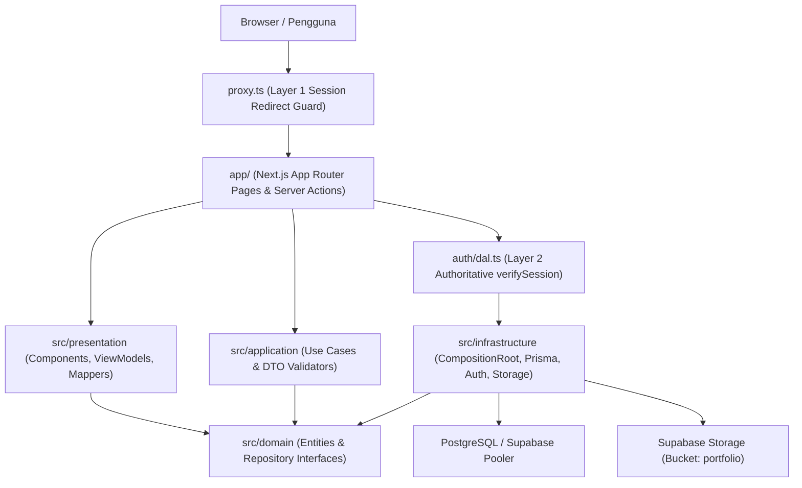

# Agun Firmansyah — Personal Portfolio & Headless CMS

Aplikasi web **Personal Portfolio & Content Management System (CMS)** bergaya **Swiss International Style**, dibangun dengan arsitektur **Clean Architecture** menggunakan **Next.js 16 (App Router + Turbopack)**, **React 19**, **TypeScript**, **Tailwind CSS v4**, **Prisma 7**, **PostgreSQL (Supabase)**, dan **Supabase Storage**.

Dirancang agar seluruh konten portofolio — mulai dari profil utama, daftar proyek, pengalaman kerja, taksonomi keahlian, sertifikat, kanal kontak, hingga urutan dan visibilitas section di landing page — dapat dikelola secara dinamis melalui panel admin (`/admin`) yang terproteksi, sekaligus memiliki mekanisme *graceful fallback* ke data statis apabila terjadi gangguan konektivitas database.

---

## Daftar Isi

1. [Fitur Utama](#1-fitur-utama)
2. [Tech Stack](#2-tech-stack)
3. [Arsitektur Sistem (Clean Architecture)](#3-arsitektur-sistem-clean-architecture)
4. [Struktur Direktori](#4-struktur-direktori)
5. [Skema Database (Prisma & PostgreSQL)](#5-skema-database-prisma--postgresql)
6. [Daftar Route Aplikasi](#6-daftar-route-aplikasi)
7. [Konfigurasi Environment Variables](#7-konfigurasi-environment-variables)
8. [Panduan Instalasi & Pengembangan Lokal](#8-panduan-instalasi--pengembangan-lokal)
9. [Konfigurasi Supabase Storage & Deployment (Vercel)](#9-konfigurasi-supabase-storage--deployment-vercel)
10. [Sistem Desain (Swiss International Style)](#10-sistem-desain-swiss-international-style)
11. [Arsitektur Keamanan](#11-arsitektur-keamanan)
12. [Pengujian & Audit Kualitas](#12-pengujian--audit-kualitas)
13. [Troubleshooting Umum](#13-troubleshooting-umum)

---

## 1. Fitur Utama

### A. Sisi Publik (Portfolio Showcase)

- **Urutan & Visibilitas Section Dinamis (`SectionConfig`)**: Admin dapat mengatur urutan tampil seluruh section (`hero`, `about`, `projects`, `experience`, `skills`, `certificates`, `contact`) serta mengaktifkan/menonaktifkan section dari CMS. Navbar, indeks nomor section (`01`, `02`, dst.), dan penghitung `SECTION XX / YY` otomatis menyesuaikan konfigurasi aktif.
- **Sticky Navbar dengan Scrollspy & Scroll Progress Bar (`Navbar.tsx`)**:
  - Menampilkan menu navigasi bersih tanpa angka prefiks (`About`, `Experience`, `Capabilities`, `Projects`, `Certificates`, `Contact`).
  - Mendeteksi section aktif secara otomatis saat halaman di-scroll (*scrollspy*) maupun saat link diklik (*smooth scroll* dengan kompensasi tinggi header sticky).
  - Indikator *reading progress bar* di bagian paling atas viewport serta drawer responsif untuk perangkat mobile.
  - Sinkronisasi `window.location.hash` dilakukan pasca-hidrasi (`requestAnimationFrame`) sehingga bebas dari *React hydration mismatch*.
- **Hero Section (`HeroSection.tsx`)**: Menampilkan identitas, *tagline*, *bio*, lokasi/zona waktu, daftar peran (`Role`), serta *Engineering Nodes* (`tag`, `title`, `description`, `stack`, status highlight).
- **About & Philosophy (`AboutSection.tsx`)**: Narasi profesional, kutipan filosofi, *Primary Domains* (`Domain`), dan *Core Engineering Pillars* (`Pillar`).
- **Projects Showcase & Detail Case Study**:
  - **Landing Page (`ProjectsSection.tsx`)**: Menampilkan **3 proyek unggulan teratas** (yang berstatus `published = true`, diurutkan berdasarkan `order`), dilengkapi tag teknologi, pratinjau thumbnail atau blok spesifikasi, tautan ke halaman detail (`/projects/[id]`), serta tombol **`[ MORE PROJECTS // VIEW ALL (N) → ]`** menuju halaman arsip proyek.
  - **Halaman Arsip Proyek (`/projects`)**: Menampilkan seluruh proyek berstatus *published* dalam grid kartu 3 kolom responsif beserta link cepat ke demo live (`projectUrl`) dan repository (`githubUrl`).
  - **Halaman Detail Proyek (`/projects/[id]`)**: Studi kasus lengkap per proyek dengan dukungan navigasi *Previous / Next Project* dan fallback resolusi ID.
- **Experience Ledger dengan Pagination (`ExperienceSection.tsx`)**:
  - Menampilkan **5 pengalaman teratas** secara default agar landing page tetap ringkas.
  - Apabila terdapat lebih dari 5 data, tombol interaktif **`+ [ MORE EXPERIENCE // VIEW ALL (N) ]`** / **`− [ SHOW LESS // TOP 5 ]`** otomatis muncul di Desktop, Tablet, dan Mobile untuk membuka seluruh daftar riwayat kerja secara *in-place*.
  - Menampilkan periode tanggal otomatis (format `Mon YYYY — Mon YYYY` atau `Mon YYYY — Present`) dan nomor urut dinamis sesuai urutan CMS.
- **Skills & Capabilities (`SkillsSection.tsx`)**: Taksonomi keahlian berbasis kategori (`SkillCategory` -> `Skill[]`) dengan tata letak editorial asimetris.
- **Certificates & Credentials**:
  - **Landing Page (`CertificatesSection.tsx`)**: Menampilkan **3 sertifikat teratas** dalam grid 3 kolom di desktop (otomatis disembunyikan bila jumlah sertifikat `0`), dilengkapi tombol **`+ [ MORE CERTIFICATES // VIEW ALL (N) → ]`**.
  - **Halaman Arsip Sertifikat (`/certificates`)**: Menampilkan seluruh sertifikat dalam grid responsif hingga 3 kolom dengan informasi penerbit, tipe berkas (`PDF Document` / `Image Credential`), tanggal terbit, ID kredensial, tombol **View Certificate ↗** (membuka file PDF/gambar), dan **Verify Credential ↗** (jika URL verifikasi tersedia).
- **Contact Section (`ContactSection.tsx`)**:
  - Tata letak 2 kolom sejajar yang ringkas di desktop (judul & deskripsi di kiri, tombol kanal kontak di kanan).
  - Desain tombol minimalis gaya Swiss (hanya menampilkan indeks, label kanal seperti `EMAIL`, `LINKEDIN`, `GITHUB`, serta panah `->` tanpa teks URL mentah, dengan tooltip `title` dan `aria-label`).
  - Normalisasi tautan otomatis di `PortfolioViewMapper.buildContactHref`: email menjadi `mailto:...`, nomor WhatsApp menjadi `https://wa.me/...`, telepon menjadi `tel:...`, dan tautan web tanpa skema otomatis dilengkapi `https://` serta dibuka di tab baru (`target="_blank"` + `rel="noopener noreferrer"`).
- **Resilient Fallback (`ResilientPortfolioRepository`)**: Menangkap kegagalan konektivitas database yang terklasifikasi eksplisit (`ECONNREFUSED`, `ETIMEDOUT`, `ENOTFOUND`, `ECONNRESET`, `P1001`, `P1002`, `P1011`, `P1017`, `TlsConnectionError`) dan mengalihkan pembacaan ke `StaticPortfolioRepository`, sambil tetap melempar ulang error konfigurasi (`P1000`, `P1003`), validasi, maupun error pemrograman (*fail-closed*).

### B. Panel Admin CMS (`/admin`)

- **Arsitektur Single-Admin**: Autentikasi akun admin tunggal berbasis sesi terenkripsi (`iron-session`) dengan verifikasi hash kata sandi `bcryptjs` (12 *salt rounds*) dan pembatalan sesi jarak jauh via `sessionVersion`.
- **Login Email atau Username + Rate Limiter**: Mendukung login dengan `username` atau `email`, dilindungi `MemoryRateLimiter` multi-dimensi (identitas, IP, dan komposit) dengan batas **5 percobaan gagal per 15 menit**.
- **Manajemen Konten Lengkap (CRUD & Reorder)**:
  - Pengelolaan singleton profil: Hero Profile, About Profile, Contact Profile.
  - Pengelolaan koleksi dengan urutan (*up/down reorder*) & modal WAI-ARIA (*accessible dialog* + penutupan via tombol `Escape`): Roles, Engineering Nodes, Domains, Pillars, Projects (halaman create/edit terdedikasi + publish toggle + upload thumbnail), Experiences (halaman create/edit terdedikasi + rentang tanggal mulai/selesai), Skill Categories & Skills, Certificates (upload file PDF/gambar + metadata), Contact Channels, dan Section Order.
  - Pengaturan Akun Admin (`/admin/account`): Ubah username/email dan ganti kata sandi (otomatis menaikkan `sessionVersion`).
- **On-Demand Cache Revalidation**: Setiap mutasi Server Action memanggil `revalidatePath()` ke halaman admin terkait, halaman utama `/`, dan halaman turunan (`/projects`, `/projects/[id]`, `/certificates`).

### C. Upload & Manajemen Berkas (Supabase Storage + Local Fallback)

- **Serverless-Safe Storage (`supabase-storage.service.ts`)**: Pada environment produksi seperti Vercel (sistem berkas *read-only*) maupun lokal saat kredensial Supabase tersedia, file sertifikat dan thumbnail proyek diunggah ke **Supabase Storage** (default bucket `portfolio`, subfolder `certificates/` dan `projects/`). Jika bucket belum tersedia dan server memakai `SUPABASE_SERVICE_ROLE_KEY`, sistem otomatis mencoba membuat bucket publik `portfolio`.
- **Local Filesystem Fallback**: Apabila kredensial Supabase Storage tidak dikonfigurasi dan aplikasi tidak berjalan di Vercel (`VERCEL !== '1'`), file disimpan aman ke `/public/uploads/certificates/` atau `/public/uploads/projects/` untuk pengujian/pengembangan offline.
- **Validasi Keamanan Berkas (`upload.service.ts`)**:
  - **Sertifikat (`CertificateUploadService`)**: Hanya mengizinkan ekstensi `.pdf`, `.png`, `.jpg`, `.jpeg`, `.webp` (MIME: `application/pdf`, `image/png`, `image/jpeg`, `image/webp`), ukuran maksimal **5 MB**, disertai pengecekan **magic-byte header** (mencegah pemalsuan `Content-Type`).
  - **Thumbnail Proyek (`ProjectUploadService`)**: Mengizinkan `.png`, `.jpg`, `.jpeg`, `.webp`, `.gif`, `.svg` hingga **5 MB** dengan verifikasi magic bytes (serta inspeksi struktur SVG dan penolakan tag berbahaya).
  - Penamaan file acak memakai `crypto.randomUUID()` dan proteksi anti *path traversal* (`CWE-22`) saat penghapusan file lama.

---

## 2. Tech Stack

| Kategori | Teknologi / Paket | Versi (`package.json`) | Peran Utama |
| :--- | :--- | :--- | :--- |
| **Framework** | Next.js (App Router + Turbopack) | `16.4.5` | SSR, Partial Prerendering (`cacheComponents`), Server Actions, Routing |
| **UI Library** | React & React DOM | `19.3.0` | Server Components & interactive Client Components |
| **Bahasa** | TypeScript | `^5` | *Type-safety* menyeluruh di semua layer Clean Architecture |
| **Styling** | Tailwind CSS & `@tailwindcss/turbopack` | `^4` | Utility-first styling dengan CSS design tokens (`@theme inline`) |
| **ORM & Database** | Prisma (`prisma`, `@prisma/client`) | `^7.10.1` | Pemodelan skema & query type-safe ke PostgreSQL |
| **Driver Adapter** | `@prisma/adapter-pg` & `pg` | `^7.10.1` / `^8.23.1` | Connection pooling PostgreSQL via driver adapter Prisma 7 |
| **Object Storage** | `@supabase/supabase-js` | `^2.119.2` | Penyimpanan cloud persisten untuk sertifikat PDF/gambar & thumbnail |
| **Autentikasi** | `iron-session` | `^9.0.1` | Cookie sesi terenkripsi AES (*HTTP-only*, `porto_admin_session`) |
| **Kriptografi** | `bcryptjs` | `^3.0.3` | Hashing password (`SALT_ROUNDS = 12`) & *timing-safe dummy compare* |
| **Linting** | ESLint & `eslint-config-next` | `^9` / `16.4.5` | Standar kualitas kode & aturan hooks React 19 / Next.js 16 |

---

## 3. Arsitektur Sistem (Clean Architecture)

Proyek ini memisahkan tanggung jawab menjadi **4 lapisan utama di dalam `src/`** ditambah **lapisan pengiriman Next.js (`app/` dan `proxy.ts`)**, di mana ketergantungan (*dependency*) mengalir ke arah dalam menuju `domain/`.



### Penjelasan Masing-Masing Layer

1. **`src/domain/` (Inti Bisnis)**
   - **`entities/`**: Definisi tipe murni entitas domain (`HeroProfile`, `AboutProfile`, `Project`, `Experience`, `SkillCategory`, `Skill`, `ContactProfile`, `ContactChannel`, `Certificate`, `SectionConfig`, `Admin`, `Portfolio`) tanpa ketergantungan framework eksternal.
   - **`repositories/`**: Kontrak/interface repository (`IPortfolioRepository`, `IAdminRepository`, `IProjectRepository`, `IExperienceRepository`, `ICertificateRepository`, `ISectionConfigRepository`, `IRateLimiter`, dll.).
2. **`src/application/` (Aturan Aplikasi)**
   - **`dtos/`**: Skema validasi dan *anti-tampering* input Server Actions (whitelist field, penolakan field sistem seperti `id`/`createdAt`/`updatedAt`, sanitasi protokol URL berbahaya seperti `javascript:` / `data:`, serta batasan panjang karakter).
   - **`use-cases/`**: Orkestrasi logika spesifik untuk setiap fitur (Auth, CRUD & Reorder seluruh modul CMS, serta `GetPortfolioUseCase`).
3. **`src/infrastructure/` (Implementasi Teknis)**
   - **`composition-root.ts`**: Container *Dependency Injection* (`CompositionRoot`) yang merakit seluruh singleton repository, service autentikasi, rate limiter, dan factory use case.
   - **`prisma/client.ts`**: Lazy proxy singleton `PrismaClient` menggunakan `PrismaPg` + `pg.Pool` dengan normalisasi SSL Supabase Pooler (`sslmode=no-verify`), `keepAlive: true`, `connectionTimeoutMillis: 10000`, serta deteksi otomatis perubahan `DATABASE_URL` (`pgPoolUrl`) saat development HMR.
   - **`repositories/`**: Implementasi repository berbasis Prisma, `StaticPortfolioRepository` (data fallback), dan `ResilientPortfolioRepository` (decorator ketahanan konektivitas).
   - **`auth/`**: `session.ts` (`iron-session`), `dal.ts` (`verifySession()` dengan React `cache()`), `password.service.ts` (`bcryptjs` 12 rounds), dan `memory-rate-limiter.ts`.
   - **`storage/`**: `supabase-storage.service.ts` dan `upload.service.ts` (validasi MIME/magic-bytes + fallback disk lokal).
   - **`utils/advisory-lock.ts`**: Utilitas advisory lock PostgreSQL untuk operasi kritikal.
4. **`src/presentation/` (Tampilan Publik & Pemetaan View)**
   - **`view-models.ts`**: Model khusus UI untuk menghindari kebocoran detail infrastruktur ke komponen.
   - **`mappers/portfolio-view-mapper.ts`**: Transformasi entitas domain menjadi ViewModel (termasuk format tanggal pengalaman, nomor indeks dinamis, status PDF/image sertifikat, serta normalisasi tautan kontak).
   - **`data/` & `utils/section-order.ts`**: Konfigurasi tipografi/grid presentasi dan utilitas pengurutan section serta tautan navbar dinamis.
   - **`components/portfolio/`**: Seluruh komponen UI publik bergaya Swiss.
5. **`app/` & `proxy.ts` (Delivery Layer)**
   - **`proxy.ts`**: Penjaga rute Edge/Node lapis pertama untuk `/admin/:path*` (redirect optimistik berdasarkan cookie sesi terenkripsi).
   - **`app/`**: Halaman publik (`/`, `/projects`, `/projects/[id]`, `/certificates`), halaman login (`/admin/login`), dashboard (`/admin/...`), serta Server Actions pada tiap modul.

---

## 4. Struktur Direktori

```text
Porto/
├── app/
│   ├── admin/
│   │   ├── (dashboard)/             # Layout terproteksi AuthGate + 17+ sub-route CMS
│   │   │   ├── about/               # Pengelolaan profil About & Philosophy
│   │   │   ├── account/             # Pengaturan username, email, & ganti password admin
│   │   │   ├── certificates/        # CRUD, upload file (PDF/gambar), & reorder sertifikat
│   │   │   ├── contact/             # Pengelolaan profil teks Contact Section
│   │   │   ├── contact-channels/    # CRUD & reorder kanal kontak (Email, LinkedIn, GitHub, dll.)
│   │   │   ├── domains/             # CRUD & reorder Primary Domains
│   │   │   ├── engineering-nodes/   # CRUD & reorder Engineering Nodes di Hero
│   │   │   ├── experiences/         # List, [id], new, & reorder riwayat pengalaman
│   │   │   ├── hero/                # Pengelolaan profil Hero & lokasi
│   │   │   ├── pillars/             # CRUD & reorder Engineering Pillars
│   │   │   ├── projects/            # List, [id], new, upload thumbnail, publish, & reorder
│   │   │   ├── roles/               # CRUD & reorder daftar Role di Hero
│   │   │   ├── sections/            # Pengaturan urutan & status aktif/nonaktif section publik
│   │   │   ├── skills/              # CRUD & reorder Kategori Skill dan item Skill
│   │   │   └── page.tsx             # Ringkasan Dashboard Admin (/admin)
│   │   ├── components/              # AdminShell, SidebarNav, Topbar, AuthGate, DashboardContent
│   │   └── login/                   # Halaman login & Server Action autentikasi (/admin/login)
│   ├── certificates/
│   │   └── page.tsx                 # Halaman arsip lengkap semua sertifikat (/certificates)
│   ├── projects/
│   │   ├── [id]/page.tsx            # Halaman detail studi kasus proyek (/projects/[id])
│   │   └── page.tsx                 # Halaman arsip lengkap proyek terpublikasi (/projects)
│   ├── globals.css                  # Design tokens Swiss Style (@theme inline) & animasi CSS
│   ├── icon.png / icon.svg          # Favicon kotak biru Swiss Style
│   ├── layout.tsx                   # Root layout (font Inter & Cascadia Mono + metadata SEO)
│   └── page.tsx                     # Landing page dinamis (/)
├── prisma/
│   ├── migrations/                  # Riwayat migrasi Prisma
│   ├── schema.prisma                # Definisi 15 model database PostgreSQL
│   └── seed.ts                      # Script seed data awal portofolio
├── public/                          # Aset statis & direktori fallback lokal /uploads/
├── scripts/
│   ├── bootstrap-admin.ts           # CLI interaktif pembuatan akun admin tunggal pertama kali
│   ├── seed-sections.ts             # Script seeding urutan default 7 section publik
│   ├── generate-icons.js            # Generator icon SVG/PNG
│   └── test-*.ts                    # Rangkaian pengujian terisolasi (zero-DB), UI audit, & integrasi
├── src/
│   ├── domain/                      # Entities & repository interfaces
│   ├── application/                 # DTO validators & use cases per modul
│   ├── infrastructure/              # CompositionRoot, Prisma client & repos, Auth, Supabase Storage
│   └── presentation/                # ViewModels, mappers, section-order utils, komponen UI
├── next.config.ts                   # Konfigurasi Next.js 16 (cacheComponents, Turbopack, HTTP security headers)
├── prisma.config.ts                 # Konfigurasi Prisma 7 CLI (membaca .env.local)
├── proxy.ts                         # Route guard /admin/:path*
├── supabase-init.sql                # Skrip DDL SQL siap pakai untuk inisialisasi tabel di Supabase
└── package.json                     # Dependensi & skrip npm
```

---

## 5. Skema Database (Prisma & PostgreSQL)

Skema didefinisikan pada `prisma/schema.prisma` (dan cadangan DDL pada `supabase-init.sql`) dengan 15 tabel PostgreSQL:

| Model Prisma | Nama Tabel SQL (`@@map`) | Jenis / Relasi | Deskripsi |
| :--- | :--- | :--- | :--- |
| `Admin` | `admins` | Autentikasi (Single-Admin) | Akun admin (`username` unik, `email` opsional unik, `passwordHash` bcrypt, `sessionVersion`) |
| `HeroProfile` | `hero_profiles` | Singleton (`id="singleton"`) | Nama, tagline, bio, lokasi (`country`, `code`, `timezone`), & disiplin utama |
| `Role` | `roles` | Koleksi (`order`) | Daftar peran utama pada Hero Section beserta flag `primary` |
| `EngineeringNode` | `engineering_nodes` | Koleksi (`order`) | Kartu proses engineering (`tag`, `title`, `description`, `stack`, `highlighted`) |
| `AboutProfile` | `about_profiles` | Singleton (`id="singleton"`) | Heading, kutipan filosofi (`quote`), serta narasi primer & sekunder |
| `Domain` | `domains` | Koleksi (`order`) | Daftar bidang fokus utama (`index`, `title`) pada About Section |
| `Pillar` | `pillars` | Koleksi (`order`) | Pilar prinsip rekayasa (`index`, `title`, `description`) |
| `Project` | `projects` | Koleksi (`order`) | Proyek (`title`, `category`, `description`, `technologies` JSON, `thumbnailUrl`, `projectUrl`, `githubUrl`, `published`, `publishedAt`) |
| `Experience` | `experiences` | Koleksi (`order`) | Riwayat kerja (`role`, `institution`, `track`, `description`, `startDate`, `endDate`) |
| `SkillCategory` | `skill_categories` | Koleksi (`order`, 1-to-N ke `Skill`) | Kategori keahlian (misal Backend, Database, Tools) |
| `Skill` | `skills` | Relasi `onDelete: Cascade` | Item keahlian di dalam `SkillCategory` (`categoryId`) |
| `ContactProfile` | `contact_profiles` | Singleton (`id="singleton"`) | Heading, label CTA, dan deskripsi pada Contact Section |
| `ContactChannel` | `contact_channels` | Koleksi (`order`) | Kanal kontak (`label`, `value` berupa email/URL/nomor) |
| `Certificate` | `certificates` | Koleksi (`order`) | Sertifikat (`title`, `issuer`, `issueDate`, `credentialId`, `credentialUrl`, `fileUrl`) |
| `SectionConfig` | `section_configs` | Koleksi (`order`, `key` unik) | Konfigurasi urutan & status aktif (`enabled`) untuk 7 section di landing page |

### Catatan Driver Adapter Prisma 7 (`src/infrastructure/prisma/client.ts`)
Prisma 7 menggunakan `@prisma/adapter-pg` dengan instance `pg.Pool`. Pada aplikasi ini, `getPrismaClient()` dirancang khusus agar tangguh untuk koneksi cloud PostgreSQL (Supabase):
- Mengonversi parameter `sslmode` di `DATABASE_URL` menjadi `sslmode=no-verify` dan mengatur `ssl: { rejectUnauthorized: false }` untuk menghindari kegagalan verifikasi rantai sertifikat *self-signed* milik pooler cloud.
- Mengaktifkan `keepAlive: true` dan `connectionTimeoutMillis: 10000` agar koneksi gagal cepat dalam 10 detik jika jaringan bermasalah.
- Menyimpan `pgPoolUrl` di `globalThis` pada mode development sehingga jika `.env.local` diperbarui saat server dev berjalan, pool lama otomatis ditutup (`pgPool.end()`) dan digantikan oleh pool baru tanpa *stale connection*.

---

## 6. Daftar Route Aplikasi

### Route Publik

| Route | Komponen / File | Fungsi |
| :--- | :--- | :--- |
| `/` | `app/page.tsx` | Landing page utama; merender section aktif sesuai `SectionConfig` secara dinamis dengan fallback resilien |
| `/projects` | `app/projects/page.tsx` | Halaman arsip semua proyek terpublikasi dalam grid 3 kolom |
| `/projects/[id]` | `app/projects/[id]/page.tsx` | Halaman detail studi kasus proyek beserta navigasi proyek sebelumnya/berikutnya |
| `/certificates` | `app/certificates/page.tsx` | Halaman arsip semua sertifikat dan kredensial terverifikasi dalam grid 3 kolom |

### Route Panel Admin (`/admin`)

Semua route selain `/admin/login` dilindungi oleh lapis ganda: `proxy.ts` dan `AuthGate` (`DAL verifySession()`).

| Route | Modul | Fungsi |
| :--- | :--- | :--- |
| `/admin/login` | Autentikasi | Halaman login admin (username atau email + rate limiter) |
| `/admin` | Dashboard | Ringkasan statistik konten portofolio & tautan cepat |
| `/admin/sections` | Section Order | Mengatur urutan tampil & visibilitas section landing page |
| `/admin/hero` | Hero Profile | Edit nama, tagline, bio, negara, timezone, & disiplin |
| `/admin/roles` | Roles | Tambah, edit, hapus, & urutkan peran di Hero |
| `/admin/engineering-nodes` | Engineering Nodes | Tambah, edit, hapus, & urutkan node proses engineering |
| `/admin/about` | About Profile | Edit heading, quote, serta narasi primer & sekunder |
| `/admin/domains` | Domains | Tambah, edit, hapus, & urutkan Primary Domains |
| `/admin/pillars` | Pillars | Tambah, edit, hapus, & urutkan Engineering Pillars |
| `/admin/projects` | Projects | Daftar proyek, toggle publish, hapus, & urutkan |
| `/admin/projects/new` | Projects (Create) | Tambah proyek baru + upload thumbnail |
| `/admin/projects/[id]` | Projects (Edit) | Edit proyek, ganti/hapus thumbnail, & perbarui teknologi |
| `/admin/experiences` | Experiences | Daftar pengalaman kerja, hapus, & urutkan |
| `/admin/experiences/new` | Experiences (Create) | Tambah pengalaman kerja baru + periode tanggal |
| `/admin/experiences/[id]` | Experiences (Edit) | Edit data pengalaman kerja |
| `/admin/skills` | Skills & Taxonomy | Kelola kategori skill dan item skill di dalamnya |
| `/admin/certificates` | Certificates | Upload file sertifikat (PDF/gambar), metadata kredensial, & urutkan |
| `/admin/contact` | Contact Profile | Edit heading, CTA label, & deskripsi Contact Section |
| `/admin/contact-channels` | Contact Channels | Tambah, edit, hapus, & urutkan kanal kontak |
| `/admin/account` | Account Settings | Ubah username/email & ganti password admin |

---

## 7. Konfigurasi Environment Variables

Buat file `.env.local` di root proyek. Berikut seluruh variabel lingkungan yang dibaca oleh aplikasi:

| Variabel | Wajib | Default / Alternatif | Keterangan |
| :--- | :--- | :--- | :--- |
| `DATABASE_URL` | **Ya** | — | String koneksi PostgreSQL. Untuk Supabase di lokal & Vercel, sangat disarankan memakai **IPv4 Transaction Pooler (port `6543`)** |
| `SESSION_SECRET` | **Ya** | Fallback: `AUTH_SECRET` | Kunci enkripsi cookie `iron-session`. **Minimal 32 karakter acak** |
| `NEXT_PUBLIC_SUPABASE_URL` | Disarankan | Fallback: `SUPABASE_URL` | URL proyek Supabase (contoh: `https://<project-ref>.supabase.co`) |
| `SUPABASE_SERVICE_ROLE_KEY` | **Ya (Production)** | Fallback: `SUPABASE_SERVICE_KEY`, `SUPABASE_SECRET_KEY`, `SUPABASE_ANON_KEY`, `NEXT_PUBLIC_SUPABASE_ANON_KEY` | Kunci akses Supabase Storage untuk upload/hapus sertifikat & thumbnail proyek tanpa hambatan RLS |
| `SUPABASE_STORAGE_BUCKET` | Tidak | `portfolio` | Nama bucket Supabase Storage tempat file disimpan |
| `TRUSTED_PROXIES` | Tidak | `""` | Atur ke `"vercel"` atau `"cloudflare"` untuk pembacaan header IP asli pada rate limiter (`VERCEL=1` otomatis terdeteksi) |
| `DEBUG_PRISMA` | Tidak | `"false"` | Set `"true"` untuk menampilkan log query Prisma di console server |

### Contoh `.env.local`

> **Penting:** Jangan pernah meng-commit `.env.local` ke Git (sudah diabaikan di `.gitignore`). Isi contoh di bawah ini hanya placeholder.

```env
# PostgreSQL / Supabase Connection (Gunakan IPv4 Pooler port 6543)
DATABASE_URL="postgresql://postgres.<PROJECT_REF>:<YOUR_DB_PASSWORD>@aws-1-ap-northeast-1.pooler.supabase.com:6543/postgres"

# Enkripsi Sesi Admin (Wajib >= 32 karakter)
SESSION_SECRET="<YOUR_RANDOM_SECRET_MIN_32_CHARACTERS>"

# Supabase Storage (Untuk upload sertifikat & thumbnail proyek di Vercel / lokal)
NEXT_PUBLIC_SUPABASE_URL="https://<PROJECT_REF>.supabase.co"
SUPABASE_SERVICE_ROLE_KEY="<YOUR_SUPABASE_SERVICE_ROLE_KEY>"
SUPABASE_STORAGE_BUCKET="portfolio"

# Konfigurasi Proxy Rate Limiter (Opsional: "", "vercel", atau "cloudflare")
TRUSTED_PROXIES=""

# Debug Query Prisma (Opsional)
DEBUG_PRISMA="false"
```

---

## 8. Panduan Instalasi & Pengembangan Lokal

### Prasyarat
- **Node.js** versi `20+`
- **npm**
- Database **PostgreSQL** lokal atau proyek **Supabase** aktif

### Langkah Setup

1. **Clone repository dan masuk ke direktori proyek**
   ```bash
   git clone https://github.com/AGUN1505/portofolioku.git
   cd portofolioku
   ```

2. **Install seluruh dependensi**
   ```bash
   npm install
   ```
   *(Skrip `postinstall` di `package.json` otomatis menjalankan `prisma generate`)*

3. **Siapkan `.env.local`**
   Buat file `.env.local` dengan konfigurasi `DATABASE_URL`, `SESSION_SECRET` (minimal 32 karakter), dan kredensial Supabase Storage seperti panduan di [Bagian 7](#7-konfigurasi-environment-variables).

4. **Sinkronisasi skema database ke PostgreSQL**
   ```bash
   npx prisma generate
   npx prisma db push
   ```
   *Alternatif:* Jika menyiapkan database Supabase baru secara manual via SQL Editor, Anda juga dapat menjalankan isi berkas `supabase-init.sql`.

5. **Jalankan seeder data awal (Opsional / Direkomendasikan untuk setup baru)**
   ```bash
   npx prisma db seed
   npx tsx scripts/seed-sections.ts
   ```
   - `prisma/seed.ts` mengisi data awal Hero, About, Projects, Experiences, Skills, dan Contact.
   - `scripts/seed-sections.ts` memastikan 7 konfigurasi section (`hero`, `about`, `projects`, `experience`, `skills`, `certificates`, `contact`) tersedia di tabel `section_configs`.

6. **Buat akun Administrator Pertama (`bootstrap-admin`)**
   Karena aplikasi menerapkan arsitektur *Single-Admin*, pembuatan akun admin pertama dilakukan melalui CLI interaktif (hanya berhasil jika tabel `admins` masih kosong):
   ```bash
   npx tsx scripts/bootstrap-admin.ts
   ```
   Ikuti prompt terminal untuk memasukkan username, email (opsional), dan *Master Password* (input disamarkan dengan `*` dan di-hash dengan bcrypt 12 rounds).

7. **Jalankan server development**
   ```bash
   npm run dev
   ```
   Akses aplikasi di browser:
   - Portofolio Publik: `http://localhost:3000`
   - Halaman Semua Proyek: `http://localhost:3000/projects`
   - Halaman Semua Sertifikat: `http://localhost:3000/certificates`
   - Panel Admin Login: `http://localhost:3000/admin/login`

8. **Build & Jalankan Mode Produksi Lokal**
   ```bash
   npm run build
   npm run start
   ```

---

## 9. Konfigurasi Supabase Storage & Deployment (Vercel)

Di lingkungan serverless seperti **Vercel**, sistem berkas bersifat *read-only* sehingga menulis file upload ke `public/uploads/...` akan gagal dengan error `EROFS: read-only file system`. Aplikasi sudah mengatasinya dengan **Supabase Storage**.

### A. Setup Supabase Storage
1. Buka **Supabase Dashboard** -> menu **Storage**.
2. Buat bucket baru bernama **`portfolio`** dengan opsi **Public bucket** aktif *(atau biarkan aplikasi membuatnya otomatis saat upload pertama apabila menggunakan `SUPABASE_SERVICE_ROLE_KEY`)*.
3. Pastikan bucket bersifat publik agar berkas sertifikat (`/certificates/<uuid>.pdf`) dan thumbnail proyek (`/projects/<uuid>.png`) dapat diakses langsung oleh pengunjung publik via URL CDN Supabase.
4. Salin **`Project URL`** (`NEXT_PUBLIC_SUPABASE_URL`) dan **`service_role` key** (`SUPABASE_SERVICE_ROLE_KEY`) dari menu **Project Settings -> API**.

### B. Format Koneksi Database untuk Vercel & Lokal
Di Supabase **Project Settings -> Database -> Connection String**, gunakan mode **Transaction Pooler (IPv4)** pada port `6543`:
```text
postgresql://postgres.<PROJECT_REF>:<PASSWORD>@aws-1-ap-northeast-1.pooler.supabase.com:6543/postgres
```
Hindari memakai *Direct Connection* (`db.<PROJECT_REF>.supabase.co:5432`) di jaringan yang belum mendukung IPv6 penuh karena dapat memicu *TCP timeout*.

### C. Variabel Lingkungan di Vercel
Tambahkan variabel berikut di **Vercel Project Settings -> Environment Variables**:
- `DATABASE_URL`
- `SESSION_SECRET` (acak, minimal 32 karakter)
- `NEXT_PUBLIC_SUPABASE_URL`
- `SUPABASE_SERVICE_ROLE_KEY`
- `SUPABASE_STORAGE_BUCKET` = `portfolio`
- `TRUSTED_PROXIES` = `vercel`

### D. Security Headers Bawaan (`next.config.ts`)
Next.js secara otomatis menyuntikkan header keamanan berikut ke semua route (`/:path*`):
- `X-Content-Type-Options: nosniff`
- `X-Frame-Options: DENY`
- `Referrer-Policy: strict-origin-when-cross-origin`
- `X-DNS-Prefetch-Control: on`
- `Permissions-Policy: camera=(), microphone=(), geolocation=()`

---

## 10. Sistem Desain (Swiss International Style)

Seluruh antarmuka publik dan admin dibangun secara konsisten mengikuti prinsip grid presisi, tipografi kontras tinggi, dan ruang negatif terstruktur (*Swiss Modernism*).

### Palet Warna & Token CSS (`app/globals.css`)

| Token CSS | Nilai Hex | Penggunaan |
| :--- | :--- | :--- |
| `--bg-primary` | `#f7f6f2` | Latar belakang kanvas utama bernuansa kertas hangat |
| `--bg-surface` | `#efece6` | Latar strip header section, badge, & permukaan sekunder |
| `--text-primary` | `#171717` | Teks utama, judul besar, tombol CTA gelap |
| `--text-secondary` | `#777777` | Subjudul, metadata monospaced, deskripsi |
| `--accent-cobalt` | `#2449d8` | Warna aksen utama (kotak brand logo, indeks `01`/`02`, hover border, garis progres) |
| `--border-subtle` | `#dcdad4` | Garis pembatas grid 1px (*hairline architectural grid*) |

### Tipografi (`app/layout.tsx`)
- **Sans-Serif Utama (`--font-sans`)**: `Inter` (untuk judul display, paragraf narasi, dan tombol).
- **Monospace Teknis (`--font-mono`)**: `Cascadia Mono` (untuk label strip indeks `[ 01 // ... ]`, tanggal, tag teknologi, dan metadata sistem).

### Responsivitas & Utilitas Animasi
- **Breakpoint**: Dioptimalkan eksplisit untuk 3 tingkat layar: Desktop (`xl: 1280px+` hingga `2xl: 1536px+` dengan lebar konten maks `1440px`), Tablet (`md: 768px` – `lg: 1279px`), dan Mobile (`< 768px`).
- **Efek Interaksi**: `ScrollReveal` berbasis `IntersectionObserver` (`.reveal-init`, `.reveal-visible`), `.hover-card-swiss`, `.glass-header-scrolled`, serta animasi radar `.radar-pulse-cobalt` dan `.radar-pulse-green`.

---

## 11. Arsitektur Keamanan

1. **Defense-in-Depth Autentikasi Admin**:
   - **Layer 1 (`proxy.ts`)**: Intercept permintaan pada matcher `/admin/:path*`, memverifikasi cookie `porto_admin_session` menggunakan `unsealSession` sebelum halaman dirender.
   - **Layer 2 (`src/infrastructure/auth/dal.ts`)**: Setiap layout terproteksi (`AuthGate`) dan setiap Server Action mutasi memanggil `verifySession()` (dibungkus React `cache()`) yang mencocokkan `userId` dan `sessionVersion` langsung ke tabel `admins`. Mengubah password otomatis menginkrementasi `sessionVersion`, sehingga seluruh sesi lama di perangkat lain seketika tidak berlaku (*revoked*).
2. **Cookie Sesi & Password Hashing**:
   - Cookie `porto_admin_session` terenkripsi dengan `iron-session` (`httpOnly: true`, `sameSite: 'lax'`, `secure: NODE_ENV === 'production'`, masa berlaku 7 hari).
   - Kata sandi di-hash menggunakan `bcryptjs` dengan 12 rounds (`PasswordService`), dilengkapi `performDummyCompare()` agar waktu respons gagal saat akun tidak ditemukan tetap seragam (mitigasi *timing attack*).
3. **Multi-Dimension Rate Limiting (`MemoryRateLimiter`)**:
   - Membatasi upaya login gagal maksimal **5 kali dalam jendela 15 menit** berdasarkan dimensi identitas (`email`/`username`), alamat IP terverifikasi (`TRUSTED_PROXIES`), dan kunci komposit.
4. **Anti-Tampering DTO & Sanitasi Input**:
   - Seluruh DTO di `src/application/dtos/` menggunakan *strict field whitelisting*: menolak input field sistem (`id`, `createdAt`, `updatedAt`) dan field liar yang tidak diizinkan.
   - URL sertifikat, proyek, dan kredensial difilter ketat untuk memblokir skema XSS seperti `javascript:`, `data:`, `vbscript:`, `file:`, `//`, dan karakter HTML berbahaya.
5. **Validasi Upload File Ketat (`upload.service.ts`)**:
   - Verifikasi ganda: ekstensi file, MIME type, batas ukuran `5 MB`, dan inspeksi *magic-byte signature* biner.
   - Penghapusan file memakai UUID yang divalidasi dan pencocokan prefiks path aman agar kebal terhadap serangan *path traversal*.

---

## 12. Pengujian & Audit Kualitas

Proyek dilengkapi pemeriksaan statis dan rangkaian skrip verifikasi otomatis di folder `scripts/`.

### Pemeriksaan Standar (Build, Types, Lint)
```bash
# 1. Type-check TypeScript menyeluruh
npx tsc --noEmit

# 2. Linting kode
npm run lint

# 3. Verifikasi production build Next.js
npm run build
```

### Rangkaian Pengujian Terisolasi (Zero-DB — Aman Dijalankan Kapan Saja)
Skrip berikut berjalan secara *in-memory* tanpa menyentuh database live:

```bash
# Audit rute admin, WAI-ARIA modal compliance, listener Escape key, & komponen publik (44 checks)
npx tsx scripts/test-frontend-ui-audit.ts

# Audit modul Sertifikat: DTO anti-tampering, magic-bytes upload, Server Actions auth, & UI (28 checks)
npx tsx scripts/test-certificates-module.ts

# Audit upload thumbnail proyek (PNG/JPEG/WEBP/GIF/SVG, magic bytes, & proteksi path traversal)
npx tsx scripts/test-project-upload-service.ts

# Audit pengurutan section dinamis, fallback statis, & otorisasi reorder
npx tsx scripts/test-section-order.ts

# Audit autentikasi berbasis email & rate limiter tanpa koneksi DB
npx tsx scripts/test-email-auth-zero-db.ts

# Audit klasifikasi error konektivitas pada ResilientPortfolioRepository (fail-closed)
npx tsx scripts/test-phase5.5.2.1-connectivity-classifier.ts

# Audit kesiapan keamanan rilis (security headers, session cookie, bcrypt, DTO hardening)
npx tsx scripts/test-security-release-readiness.ts
```

> **Catatan:** Jangan menjalankan skrip warisan seperti `scripts/verify-guardrails.ts` pada database aktif karena skrip tersebut khusus baseline tahap awal (*staging*) yang mengasumsikan tabel `admins` dan `contact_channels` masih kosong (`0`).

---

## 13. Troubleshooting Umum

| Gejala / Error | Penyebab | Solusi |
| :--- | :--- | :--- |
| `PrismaClientKnownRequestError: Operation has timed out` di lokal | `DATABASE_URL` masih memakai koneksi langsung (`db.<ref>.supabase.co:5432`) yang hanya memiliki IPv6 sehingga macet di jaringan IPv4, atau dev server memakai cache `pg.Pool` lama setelah `.env.local` diubah. | 1. Gunakan **Supabase IPv4 Transaction Pooler** port `6543` (`aws-*-pooler.supabase.com:6543/postgres`) di `.env.local`.<br>2. Restart `npm run dev` jika mengubah `.env.local`. (`src/infrastructure/prisma/client.ts` juga sudah otomatis mereset `pg.Pool` saat `DATABASE_URL` berubah via HMR). |
| `(ENOTFOUND) tenant/user postgres.<ref> not found` | Host region pooler atau format username `postgres.<PROJECT_REF>` tidak sesuai dengan proyek Supabase pada dashboard. | Salin ulang string koneksi **Transaction Pooler** persis dari *Supabase Dashboard -> Database -> Connect* (perhatikan subdomain `aws-0-...` vs `aws-1-...` dan format `postgres.<PROJECT_REF>`). |
| `EROFS: read-only file system, open '/var/task/public/uploads/...'` di Vercel | Aplikasi mencoba menyimpan upload ke disk lokal padahal kredensial Supabase Storage di Vercel belum diatur. | Tambahkan `NEXT_PUBLIC_SUPABASE_URL`, `SUPABASE_SERVICE_ROLE_KEY`, dan `SUPABASE_STORAGE_BUCKET="portfolio"` pada Environment Variables Vercel lalu redeploy. |
| `SESSION_SECRET environment variable is missing or shorter than 32 characters` | Variabel `SESSION_SECRET` (atau `AUTH_SECRET`) belum diset atau panjangnya kurang dari 32 karakter. | Isi `SESSION_SECRET` dengan string acak minimal 32 karakter di `.env.local` dan Vercel Environment Variables. |
| Tombol `More Experience` belum muncul di landing page | Fitur pagination Experience (`initialLimit = 5`) memang sengaja menyembunyikan tombol jika total experience masih `<= 5`. | Tambahkan data experience ke-6 dan seterusnya melalui `/admin/experiences`, maka tombol `More Experience` otomatis muncul. |
